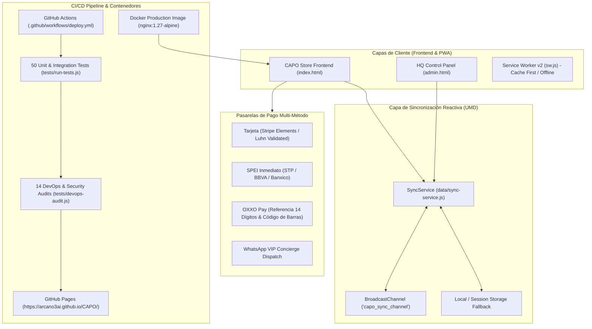

# 👑 CAPO Store - Lujo Urbano & Gorras Exclusivas

Plataforma e-commerce completa de alto rendimiento con arquitectura *Dark Brutalist / Streetwear* diseñada para la marca de gorras de lujo urbano **CAPO**.

---

## 🏗️ Arquitectura de Ingeniería & DevOps



---

## ⚡ Suite E-Commerce & Capacidades Enterprise (v4.0)

### 💳 Pasarela Multi-Método con Tarjeta Virtual 3D
- **Tarjeta Débito/Crédito:** Tarjeta virtual interactiva con chip dorado, detección automática de marca (Visa, Mastercard, AMEX, Discover, Carnet) y validación en tiempo real por **Algoritmo de Luhn**.
- **SPEI Inmediato:** Despliegue de CLABE interbancaria oficial (`646180157023948192`), razón social y concepto dinámico con el folio de la orden con copiado en 1-clic.
- **OXXO Pay:** Código de barras generado visualmente y referencia de 14 dígitos con vigencia de 48 horas.
- **WhatsApp Concierge:** Pedido directo pre-formateado al equipo central.

### 🌐 Motor Multi-Divisa en Tiempo Real
- Selector en la barra de navegación entre **MXN ($)**, **USD ($)** y **EUR (€)** con conversión al vuelo de precios, subtotales, cupones y recibos.

### 🔎 Buscador Predictivo Instantáneo
- Autocompletado en tiempo real con resaltado de términos (`<mark>`), miniaturas y botón de inspección directa.

### ⭐ Sistema de Reseñas Verificadas (UGC)
- Módulo de reputación dinámico con cálculo de promedio de estrellas, barras de distribución y modal de envío de opiniones con insignia de compra verificada.

### 🎛️ Centro de Control HQ & Panel de Administración (`admin.html`)
- **Acceso Protegido por PIN:** Terminal administrativa protegida por clave de acceso (`CAPO2026`).
- **Métricas en Vivo (KPIs):** Ventas totales, número de órdenes, piezas despachadas y ticket promedio en Pesos Mexicanos.
- **Gestión de Órdenes & Actualización de Rastreo:**
  - Selector de estatus en tiempo real (*1. Orden Recibida*, *2. Embalaje Blindado*, *3. En Ruta Express*, *4. Entregado*), sincronizado reactivamente con el radar del cliente.
  - Enlace directo a WhatsApp para contactar al cliente con mensaje pre-llenado.
- **Control de Inventario en Tiempo Real:** Ajuste dinámico de existencias con deducción automática tras cada compra y detección de *Sold-Out*.
- **Moderación de Reseñas & Lista de Espera:** Gestión de feedback de clientes y avisos de reabastecimiento.
- **Exportación de Datos:** Descarga de órdenes en archivo `.csv`.

---

## 🛡️ DevOps, SRE & Especificaciones de Infraestructura

### 1. Auditoría Automatizada (64 Comprobaciones)
Ejecutable mediante `npm test`:
```bash
npm test
# Ejecuta:
# 1. tests/run-tests.js     (50 pruebas unitarias y de integración)
# 2. tests/devops-audit.js   (14 verificaciones SRE, seguridad, PWA y zero-404s)
```

### 2. Optimización de Assets (Reducción de >34 MB)
- Eliminación de archivos RAW sin comprimir (`.wav` de 15.7 MB y `.png` de 18.4 MB) a favor de formatos de alta densidad:
  - Imágenes en **WebP** (ahorro superior al 85% por archivo).
  - Soundtrack oficial en **MP3 a 192 kbps** (reducido de 15.7 MB a 1.9 MB sin pérdida perceptible).
- El video del hero permanece con `opacity: 1` y máxima nitidez visual.

### 3. Contenedor de Producción (Docker & Nginx)
Configurado con `nginx:1.27-alpine`, compresión Gzip, cabeceras de seguridad OWASP (`X-Frame-Options`, `X-Content-Type-Options`, `Permissions-Policy`), healthcheck `/health` y caché inmutable de 1 año para assets estáticos.

```bash
# Construir y levantar con Docker Compose en http://localhost:8080:
docker-compose up -d --build

# Ver logs del contenedor:
docker-compose logs -f

# Detener el servicio:
docker-compose down
```

---

## 📦 Estructura del Repositorio

```
CAPO/
├── .github/
│   └── workflows/
│       └── deploy.yml        # CI/CD: Tests + DevOps Audit + GitHub Pages
├── assets/                   # Video (MP4), audio (MP3) e imágenes (WebP)
├── data/
│   ├── products.json         # Catálogo estructurado con SKUs, stock y specs
│   └── sync-service.js       # Capa de datos desacoplada y eventos cross-tab (UMD)
├── tests/
│   ├── run-tests.js          # 50 Pruebas unitarias de e-commerce y pagos
│   └── devops-audit.js       # 14 Verificaciones de seguridad, assets y SRE
├── Dockerfile                # Imagen Docker de producción con Nginx Alpine
├── docker-compose.yml        # Orquestación de contenedor con healthchecks
├── nginx.conf                # Configuración Nginx de alto rendimiento
├── .dockerignore             # Exclusión de archivos de build
├── package.json              # Scripts DevOps estándar de Node.js
├── manifest.json             # Manifiesto PWA para instalación móvil
├── sw.js                     # Service Worker v2 con estrategia offline
├── index.html                # Tienda principal con Schema.org JSON-LD
├── admin.html                # Panel de Administración HQ protegido por PIN
├── styles.css                # Sistema de diseño brutalista y responsive
├── script.js                 # Motor de estado, carrito, checkout y módulos
└── README.md                 # Documentación técnica completa
```

---

## 💻 Ejecución en Local

```bash
# Opción 1: Servidor local nativo (Puerto 3000):
npm run dev
# o: python -m http.server 3000

# Opción 2: Con Contenedor Docker (Puerto 8080):
npm run docker:run
```

- **Tienda Principal:** `http://localhost:3000` (o `http://localhost:8080` con Docker)
- **Panel HQ:** `http://localhost:3000/admin.html` *(PIN: `CAPO2026`)*
- **Healthcheck:** `http://localhost:8080/health` *(Con Docker)*

---

## 🔗 Despliegue Oficial en Producción

- **Repositorio Git:** [https://github.com/Arcano3Ai/CAPO](https://github.com/Arcano3Ai/CAPO)
- **Despliegue GitHub Pages:** [https://arcano3ai.github.io/CAPO/](https://arcano3ai.github.io/CAPO/)
- **Rama:** `main`
